<div align="center">
  
</div>

<div align="center">
  <a href="https://git.io/typing-svg">
    
  </a>
</div>

<br/>

<div align="center">
  <a href="https://leetcode.com/u/pavel-hasan-joy/" target="_blank">
    
  </a>
  &nbsp;
  
  &nbsp;
  
  &nbsp;
  
</div>

<br/>

<div align="center">
  <a href="https://leetcode.com/u/pavel-hasan-joy/" target="_blank">
    
  </a>
</div>

---

## 🌌 Overview

> *"Consistency and first-principles thinking are the foundations of great software engineering."*

Welcome to my personal repository documenting my daily algorithmic problem-solving journey on **[LeetCode](https://leetcode.com/u/pavel-hasan-joy/)**.

This repository is **language-agnostic** and automatically synchronized via **LeetHub v3** whenever a problem is submitted and accepted on LeetCode. Every entry contains the verified source code, detailed problem description, and runtime/memory benchmarks.

---

## 📊 Live LeetCode Telemetry

<div align="center">
  <a href="https://leetcode.com/u/pavel-hasan-joy/" target="_blank">
    
  </a>
</div>

---

## 🎯 Engineering Objectives

- 🧠 **Algorithmic Mastery:** Breaking down complex computational challenges into elegant, predictable data flow.
- ⚡ **Asymptotic Optimization:** Focusing on optimal Big-O Time and Space complexities ($O(1)$, $O(\log N)$, $O(N)$).
- 🔄 **Pattern Generalization:** Recognizing core paradigms across Two Pointers, Sliding Window, Monotonic Stacks, Dynamic Programming, and Graph Traversals.
- 🛠️ **Multi-Language Adaptability:** Expressing logic cleanly regardless of syntax—whether in low-level systems languages, object-oriented languages, or modern functional paradigms.

---

## 📂 Repository Structure

All submissions are automatically categorized by difficulty level and problem topic:

```plaintext
LeetCode-Solutions/
├── 🟢 Easy/             # Fundamental patterns, baseline algorithmic mechanics
├── 🟡 Medium/           # Core algorithmic challenges, DP, Graphs, Search trees
└── 🔴 Hard/             # Complex state spaces, advanced data structures & optimizations
```

Each problem directory contains:
- `README.md` — The complete problem statement, constraints, and test examples.
- `solution.*` — The clean, benchmarked solution code with optimal runtime.

---

<div align="center">
  
</div>

<div align="center">
  <sub>Maintained with ❤️ by <a href="https://github.com/pavel-hasan-joy">Pavel Hasan Joy</a> • Synced via LeetHub</sub>
</div>

<!---LeetCode Topics Start-->
# LeetCode Topics
## Array
| Problem Name | Difficulty |
| ------- | ------- |
| [2089-find-target-indices-after-sorting-array](https://github.com/pavel-hasan-joy/LeetCode-Solutions/tree/main/2089-find-target-indices-after-sorting-array/) | Easy |
## Binary Search
| Problem Name | Difficulty |
| ------- | ------- |
| [2089-find-target-indices-after-sorting-array](https://github.com/pavel-hasan-joy/LeetCode-Solutions/tree/main/2089-find-target-indices-after-sorting-array/) | Easy |
## Sorting
| Problem Name | Difficulty |
| ------- | ------- |
| [2089-find-target-indices-after-sorting-array](https://github.com/pavel-hasan-joy/LeetCode-Solutions/tree/main/2089-find-target-indices-after-sorting-array/) | Easy |
<!---LeetCode Topics End-->